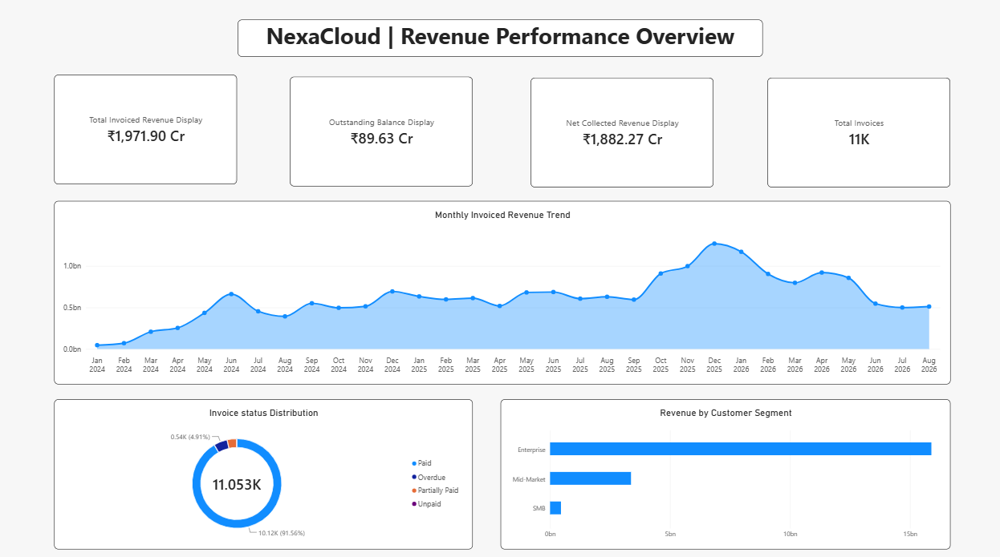
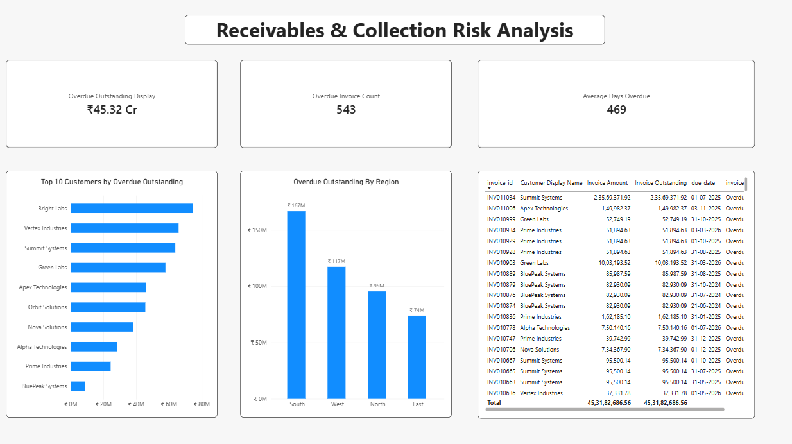
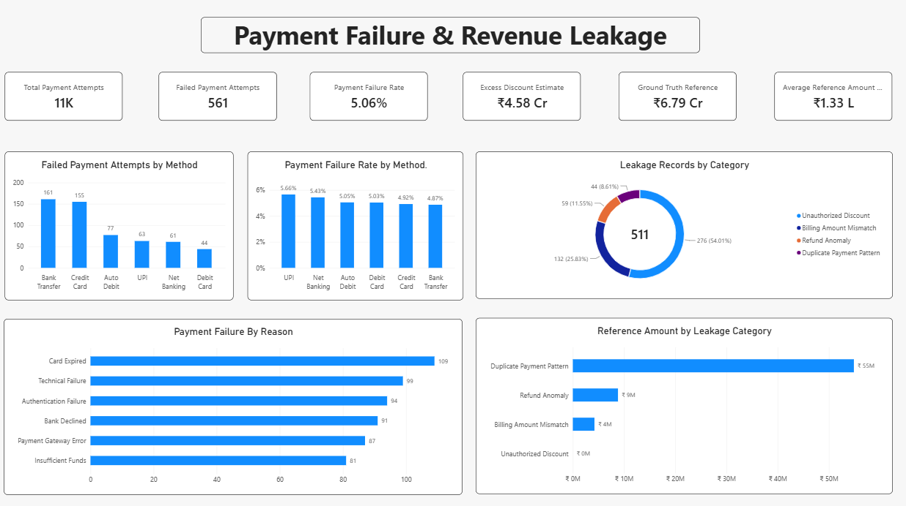

# NexaCloud Technologies — Revenue Leakage Detection

An end-to-end data analytics project investigating potential revenue leakage patterns using **Python, MySQL, and Power BI**.

## 1. Project Overview

This project simulates a revenue assurance investigation for NexaCloud Technologies, a fictional B2B technology company.

The objective is to analyse transactional data, identify unusual revenue and payment patterns, validate potential anomalies, and present business findings through an interactive Power BI dashboard.

## 2. Business Problem

Revenue leakage can occur through duplicate collections, billing inconsistencies, discounts beyond approved limits, refund anomalies, and delayed customer payments.

This project investigates these areas to identify potential financial risks and operational control weaknesses.

## 3. Tools and Technologies

| Tool | Application |
|---|---|
| Python | Data cleaning and exploratory data analysis |
| MySQL | SQL investigation and validation |
| Power BI | Data modelling, DAX and interactive dashboards |

## 4. Explore the Project Files

| Component | File | Description |
|---|---|---|
| Python | [Data Exploration Notebook](notebooks/01_Data_Exploration.ipynb) | Data inspection and exploratory analysis |
| SQL | [SQL Investigation](sql/SQL_Investigation.sql) | Original SQL investigation and validation queries |
| Power BI | [Interactive Dashboard (PBIX)](powerbi/NexaCloud_Revenue_Leakage_Analysis.pbix) | Downloadable Power BI report |
| Dashboard Preview | [Dashboard PDF](powerbi/NexaCloud_Revenue_Leakage_Analysis.pdf) | Exported dashboard pages for quick review |

## 5. Dataset Overview

| Table | Records |
|---|---:|
| Customers | 1,000 |
| Contracts | 1,167 |
| Invoices | 11,053 |
| Payments | 11,097 |
| Refunds | 782 |
| Leakage Ground Truth | 511 |

## 6. Investigation Areas and Findings

### Duplicate Payment Pattern
- 44 ground-truth flagged invoice records.
- 42 records showed successful payment totals twice the invoice amount.
- 2 records did not show excess successful collections in the payment data and require separate review.

### Billing Amount Mismatch
- 132 flagged records.
- All reference amounts matched 2% of the invoice base amount.
- The business meaning of this reference rule requires further interpretation.

### Unauthorized Discount
- 276 flagged invoices exceeded the approved discount percentage in the analysis.
- Indicative excess discount: approximately ₹4.58 crore.
- This is an analytical estimate, not a verified realised revenue loss.

### Refund Anomaly
- 59 flagged records mapped to payment IDs.
- The relevant completed refund status was `COMPLETED`.
- Ground-truth reference amounts followed a 20% relationship to original payment amounts.

### Ground-Truth Reference Amount

The supplied reference records total approximately **₹6.79 crore**.

This is a dataset-provided reference amount, not a confirmed cash-loss figure.

## 7. Power BI Dashboard

The report contains three analytical pages:

1. **Revenue Overview** — invoiced revenue, net collections, outstanding balance, invoice trends, invoice status, and customer segments.
2. **Receivables Analysis** — overdue receivables, overdue invoice count, average days overdue, and customer-level exposure.
3. **Payment Failure & Revenue Leakage Analysis** — payment attempts, failed payments, failure rate, indicative excess discounts, and ground-truth reference amounts.

For a quick view, open the [Power BI Dashboard PDF](powerbi/NexaCloud_Revenue_Leakage_Analysis.pdf). To explore the report interactively, download the [Power BI PBIX file](powerbi/NexaCloud_Revenue_Leakage_Analysis.pbix) and open it in Power BI Desktop.

## 8. Project Workflow

1. Data cleaning and exploratory analysis using Python.
2. Importing operational datasets into MySQL.
3. SQL-based investigation of revenue, payments, refunds, discounts, and receivables.
4. Validation against supplied ground-truth records.
5. Data modelling and dashboard development in Power BI.

### Dashboard Previews

**1. Revenue Performance Overview**

**2. Receivables & Collection Risk Analysis**

**3. Payment Failure & Revenue Leakage Analysis**

## 9. Limitations

- The project uses a synthetic dataset.
- Ground-truth reference amounts are not independently verified financial losses.
- Indicative excess discounts require business-rule validation.
- Potential anomalies should be investigated further before financial conclusions are made.

## 10. Repository Structure

The repository will include:

- `notebooks/` — Python cleaning and EDA notebook.
- `sql/` — Original SQL investigation.
- `powerbi/` — Power BI report and dashboard screenshots.
- `data/` — Dataset files, subject to size and sharing considerations.
- `docs/` — Supporting project documentation.

## 11. Author

**Gowtham D** 

